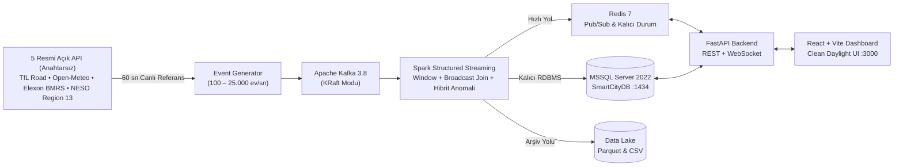

# Proje 15: Gerçek Zamanlı Akıllı Şehir Veri Platformu (Londra)

Büyük Veri Analitiği dersi kapsamında geliştirilmiş, **Docker Compose** ile tek komutta ayağa kalkan, **5 sıfır anahtarlı (zero-key) resmi Londra/Birleşik Krallık açık API'si** destekli uçtan uca **Gerçek Zamanlı Akıllı Şehir Veri Platformu**.

- **Problem:** Birden fazla IoT kaynağından (**Trafik + Hava Durumu + Hava Kalitesi + Enerji**) gelen verilerin gerçek zamanlı toplanması, işlenmesi, anomali tespiti ve görselleştirilmesi.
- **Araştırma Sorusu:** *Gerçek zamanlı karar vermek (Streaming Analytics) ile toplu veri analitiği (Batch Analytics) arasındaki mimari fark nedir?*

---

## Sistem Mimarisi



---

## Kullanılan Gerçek Açık Veri API'leri (API Anahtarı Gerektirmez)

| Kaynak | Sağlayıcı | Endpoint | Çekilen Canlı Veriler |
| :--- | :--- | :--- | :--- |
| **Trafik** | Transport for London (TfL) Unified Road API | `https://api.tfl.gov.uk/Road` | 24 gerçek Londra ana yol koridoru (`A2`, `A4`, `A23`, `A406`, `Blackwall Tunnel`, `City Route` vb.) canlı şiddet & aksama durumu |
| **Hava Durumu** | Open-Meteo Forecast | `https://api.open-meteo.com/v1/forecast` | 32 Londra bölgesi koordinatında canlı sıcaklık (°C), nem (%), rüzgar (m/s), yağış |
| **Hava Kalitesi** | Open-Meteo Air Quality | `https://air-quality-api.open-meteo.com/v1/air-quality` | 32 Londra bölgesi koordinatında canlı Avrupa AQI (EAQI), PM2.5, PM10, NO₂, O₃ |
| **Enerji (Yük)** | Elexon BMRS Insights API | `https://data.elexon.co.uk/bmrs/api/v1/demand/outturn/summary` | 5 dakikalık resmi Birleşik Krallık canlı elektrik yükü (`MW`) |
| **Enerji (Karbon)** | NESO UK Carbon Intensity (Region 13: London) | `https://api.carbonintensity.org.uk/regional/regionid/13` | Resmi Londra Bölge 13 karbon yoğunluğu (`gCO₂/kWh`) ve yenilenebilir enerji karması (`%`) |

> **API-Grounded Stream Engine:** Arka plandaki poller her 60 saniyede bir Londra'nın canlı gerçek verilerini çeker; Event Generator ise bu gerçek referansları 32 tekil Londra bölgesine (her bölgenin kendi gerçek TfL yol koridorlarıyla eşleştirerek) dağıtır ve seçilen hızda (`100 / 500 / 2.000 / 5.000+ ev/sn`) kesintisiz Kafka'ya aktarır.

---

## Hızlı Başlangıç (Docker Compose)

```powershell
docker compose up -d --build
```
- **Canlı Dashboard:** `http://localhost:3000`
- **Backend Sağlık & Kaynak Kontrolü:** `http://localhost:8000/api/sources`
- **Kalıcı MSSQL Özeti (API):** `http://localhost:8000/api/storage/summary`
- **MSSQL (SSMS / Azure Data Studio) Bağlantısı:**
  - **Server:** `localhost,1434` *(yerel SQL Server'ın 1433 portuyla çakışmaması için 1434)*
  - **Authentication:** SQL Server Authentication
  - **Login:** `sa` | **Password:** `SmartCity#2026!` *(veya `.env` içindeki `MSSQL_SA_PASSWORD`)*
  - **Database:** `SmartCityDB` (`dbo.alan_ozetleri`, `dbo.bolge_olcumleri`, `dbo.anomali_uyarilari`, `dbo.batch_telemetri`, `dbo.platform_durumu`, `dbo.vw_saatlik_sehir_ozeti`, `dbo.vw_son_bolge_durumu`, `dbo.vw_son_uyarilar` — tüm tablo, görünüm ve sütunlar Türkçe ASCII `snake_case` standardındadır)
  - **Önemli:** Container'ları yeniden oluştururken verileri korumak için `docker compose down` / `docker compose up -d --build` kullanın; volume'ları silen `docker compose down -v` komutunu kullanmayın.

### Otomatik Testler
```powershell
pytest -v
```

### Durdurma
```powershell
docker compose down
```
