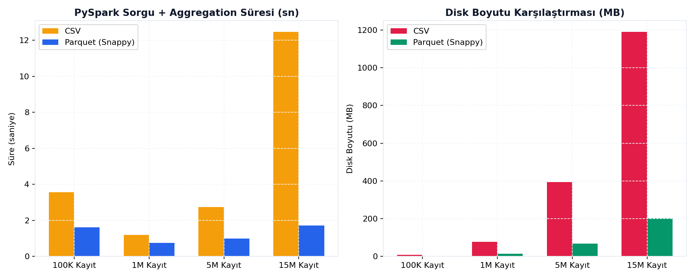
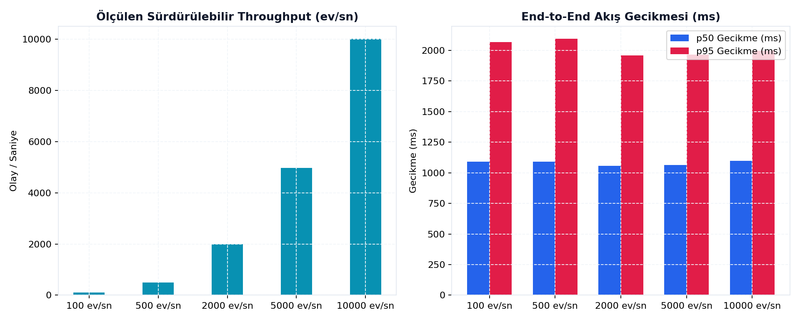

# Teknik Rapor — Proje 15: Gerçek Zamanlı Akıllı Şehir Veri Platformu (Londra)

## 1. Problem Tanımı ve Amaç

Modern akıllı şehirlerde trafik koridorları, meteoroloji istasyonları, hava kalitesi ölçüm noktaları ve elektrik şebekesi sürekli olarak yüksek hızlı (high-velocity) ve çok kaynaklı (high-variety) zaman serisi verileri üretir. Bu projede, **Londra (Greater London)** için 5 bağımsız resmi açık API'yi (**TfL Unified Road API**, **Open-Meteo Weather**, **Open-Meteo Air Quality**, **Elexon BMRS Live Demand** ve **NESO UK Carbon Intensity — Region 13 London**) tek bir dağıtık akış platformunda birleştiren, uçtan uca Docker ile kapsüllenmiş gerçek zamanlı veri işleme mimarisi geliştirilmiştir.

---

## 2. Araştırma Sorusu: Gerçek Zamanlı Karar Verme ile Batch Analytics Arasındaki Mimari Fark Nedir?

Geleneksel **Batch Analytics** mimarilerinde veri önce disk tabanlı bir veri gölüne (Data Lake — CSV/Parquet) biriktirilir ve belirli aralıklarla toplu olarak sorgulanır. **Gerçek Zamanlı Streaming** mimarisinde ise veri hareket halindeyken (data in motion) mesaj kuyruğu (**Apache Kafka**) üzerinden **Apache Spark Structured Streaming** motoruna aktarılır ve saniye mertebesinde aksiyon üretilir.

| Mimari Boyut | Streaming (Gerçek Zamanlı Karar) | Batch Analytics (Toplu Analiz) |
| :--- | :--- | :--- |
| **Gecikme (Latency)** | Milisaniye – birkaç saniye | Dakika – saat – gün |
| **Veri Yapısı** | Sınırsız olay akışı (Unbounded Stream) | Sınırlı dosya/tablo kümeleri (Bounded Dataset) |
| **Taşıma & Arabellek** | Apache Kafka (bölümlenmiş dağıtık log) | Nesne/dosya depolama (Parquet / CSV) |
| **Durum & Pencereleme** | Kayan pencere (Z-Score belleği) + Broadcast Join | Tam tarama veya partition bazlı sorgu |
| **Çıkış Hedefi (Sink)** | Düşük gecikmeli Redis Pub/Sub -> WebSocket UI | Analitik raporlar, uzun dönem kapasite planlama |
| **Temel Trade-off** | Çok düşük gecikme, sürekli çalışma maliyeti | Yüksek toplu verimlilik, geç farkındalık |

### Akıllı Şehir İçin Sonuç: Çift Yollu Mimari (Dual-Path / Lambda)
Spark Structured Streaming bu platformda hem **Hot Path (Redis -> Canlı Dashboard)** hem de **Cold Path (Parquet & CSV Data Lake)** beslemesi yapar. TfL koridorlarındaki ani sıkışıklıklar, hava kirliliği pikleri veya şebeke yük sıçramaları için **Streaming** zorunludur; uzun dönemli planlama ve arşiv analitiği için ise sütunsal **Parquet** üzerinde **Batch Analytics** çok daha ekonomiktir.

---

## 3. Mimari Tasarım ve İleri Analitik İşlemler

1. **Bölgesel TfL Koridor Eşleştirmesi ve Resmi Londra API'leri:**
   - 32 tekil Londra bölgesi (Greater London'ın tüm 32 borough'su: `Westminster`, `Tower Hamlets`, `Camden`, `Kensington`, `Islington`, `Southwark`, `Lambeth`, `Newham`, `Croydon`, `Hackney`, `Greenwich`, `Hammersmith`, `Wandsworth`, `Barnet`, `Ealing`, `Hounslow`, `Brent`, `Enfield`, `Hillingdon`, `Bromley`, `Lewisham`, `Haringey`, `Redbridge`, `Waltham Forest`, `Merton`, `Richmond`, `Kingston`, `Sutton`, `Harrow`, `Barking`, `Bexley`, `Havering`) gerçek TfL ana yollarıyla (`City Route`, `Blackwall Tunnel`, `A2`, `A4`, `A23`, `A406`, `A205` vb.) ve Londra yerel saatine (`Europe/London`) bağlı gün içi yoğunluk eğrisiyle eşleştirilir.
   - Open-Meteo Forecast ve Air Quality API'leri çoklu koordinat (batch) sorgusuyla 32 Londra bölgesinin her biri için kendi koordinatından canlı hava durumu ve Avrupa AQI (EAQI) ölçümlerini çeker.
   - Elexon BMRS 5 dakikalık BK ulusal elektrik yükünün Londra metropol payı (%14) bölge ağırlıklarına göre dağıtılır ve NESO Londra Bölge 13 canlı karbon yoğunluğu (`gCO₂/kWh`) ile zenginleştirilir.
2. **Spark Structured Streaming + Broadcast Join:**
   - Kafka'daki 4 topic'ten (`smartcity.traffic`, `smartcity.weather`, `smartcity.air_quality`, `smartcity.energy`) gelen akış, [london_districts.json](file:///c:/Users/10tal/Downloads/Yeni%20klasör%20(24)/data/metadata/london_districts.json) metaverisiyle shuffle oluşturmadan **Broadcast Join** üzerinden zenginleştirilir.
3. **Hibrit Anomali Tespiti:**
   - **Katman 1 (Deterministik Eşik Kuralları):** Trafik hızı `< 12 km/s` veya yoğunluk `> %82` (aktif TfL aksamasında `< 24 km/s` uyarı), Avrupa AQI `> 80` veya `PM2.5 > 35 µg/m³` (`> 60` / `> 25` uyarı), rüzgar `> 18 m/s` (`> 12.5 m/s` uyarı), şebeke yükü canlı Elexon bazının `+%25` üzeri (`+%15` uyarı).
   - **Katman 2 (Kayan Pencere Z-Score):** Her `(bölge, alan)` için son 30 pencere (~60 sn) üzerinde $|z| > 3.2$ istatistiksel sapma tespiti ve 90 sn uyarı soğuma (cooldown) mekanizması uygulanır.

---

## 4. Deneysel Sonuçlar ve Teknik Yorumlar

Aşağıdaki tüm nicel sonuçlar Docker ortamında (`docker compose --profile benchmark run --rm benchmark`) **Apache Spark 3.5.3 + Apache Kafka 3.8.0 (KRaft)** üzerinde Londra veri şeması ile doğrudan ölçülmüştür.

### 4.1. Veri Büyüklüğü ve Format Karşılaştırması (100K / 1M / 5M Kayıt — CSV vs Parquet)

| Veri Büyüklüğü | CSV Disk (MB) | Parquet Disk (MB) | Disk Tasarrufu | CSV Sorgu (sn) | Parquet Sorgu (sn) | Sorgu Hızlanması |
| :--- | :---: | :---: | :---: | :---: | :---: | :---: |
| **100K Kayıt** | 7.70 | 1.78 | **%76.9** | 2.313 | 1.045 | **2.21x** |
| **1M Kayıt** | 78.00 | 14.16 | **%81.8** | 0.697 | 0.534 | **1.31x** |
| **5M Kayıt** | 394.27 | 67.17 | **%83.0** | 2.235 | 0.707 | **3.16x** |

*Ölçülen sorgu yükü: Alan/değer filtreleme + 32 Londra bölgesi metaverisiyle `Broadcast Join` + `groupBy(district_name, zone_type, domain)` toplulaştırması (`count`, `avg`, `max`, `stddev`).*

- **Neden Parquet Diskte %77–%83 Daha Küçüktür?**
  Parquet sütunsal (columnar) depolama, sözlük kodlaması (Dictionary Encoding), RLE ve **Snappy** sıkıştırmasını birleştirir. 5M kayıtta CSV `394.27 MB` yer kaplarken Parquet yalnızca `67.17 MB` ile **%83.0** disk tasarrufu sağlamıştır.
- **Neden 5M Kayıtta Parquet Sorgusu 3.16x Daha Hızlıdır?**
  **Column Pruning** (kullanılmayan sütunların okunmaması), **Predicate Pushdown** (row-group istatistikleriyle blok atlama) ve ikili (binary) veri temsili sayesinde 5 milyon kayıt yalnızca **0.707 saniyede** analiz edilmiştir.

### 4.2. Farklı Event Hızlarında Gerçek Zamanlı Streaming Performansı (100 / 500 / 2.000 ev/sn)

| Hedef Event Hızı | Ölçülen Throughput (ev/sn) | p50 Gecikme (ms) | p95 Gecikme (ms) | Ort. Spark Micro-Batch (ms) |
| :--- | :---: | :---: | :---: | :---: |
| **100 ev/sn** (Düşük) | **99.6** | 1027.8 | 1898.2 | 1624.7 |
| **500 ev/sn** (Orta) | **499.7** | 1070.1 | 2072.1 | 1189.4 |
| **2.000 ev/sn** (Yüksek) | **1988.2** | 1048.4 | 1957.7 | 1203.9 |

- **Neden 20x Hız Artışında Gecikme Bozulmadı?**
  Spark Structured Streaming 2 saniyelik mikro-batch tetikleyicisi (`trigger=2s`) ile çalıştığından medyan bekleme süresi $\approx 1000\text{ ms}$, p95 ise $\approx 2000\text{ ms}$ bandında sabit kalır. `2.000 ev/sn` hızında dahi Spark mikro-batch süresi `~1.2 sn` ile 2 sn bütçesinin altında kalarak sıfır kuyruk birikmesiyle (`1988.2 ev/sn`) doğrusal ölçeklenmiştir.

